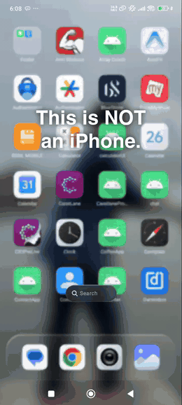
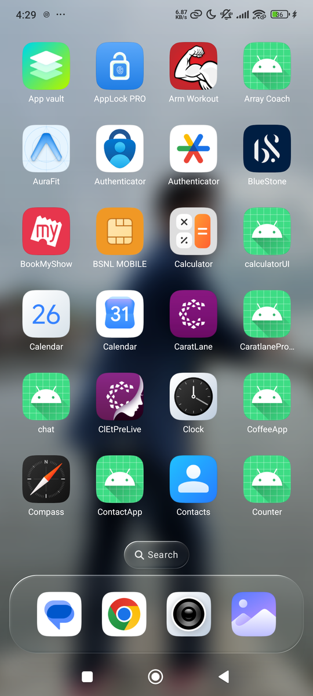
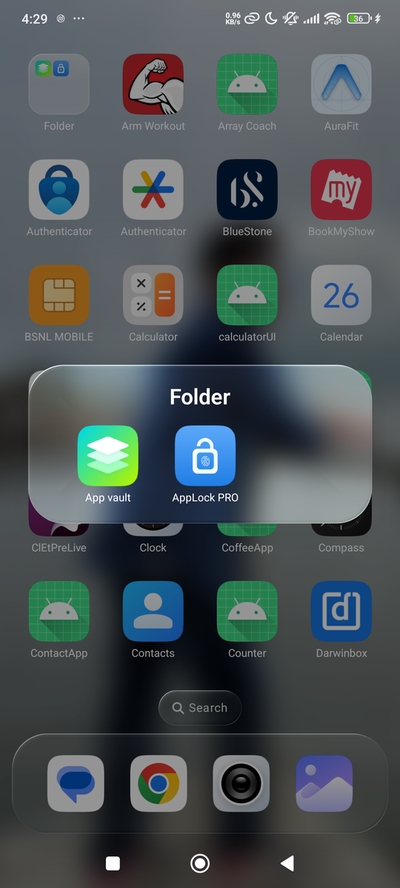
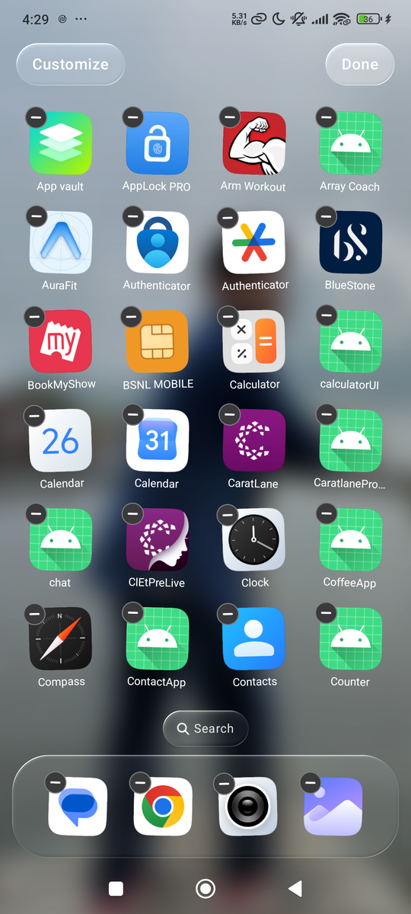
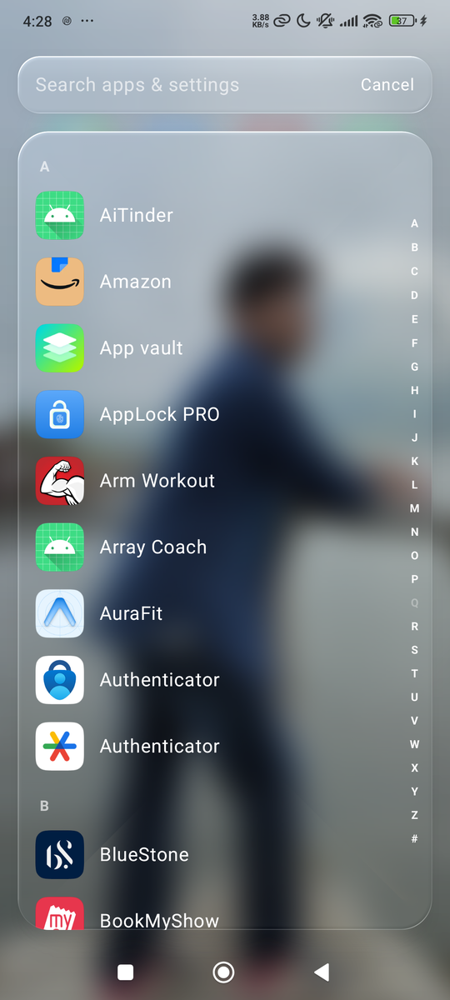
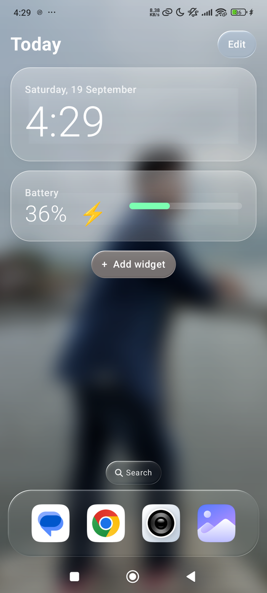
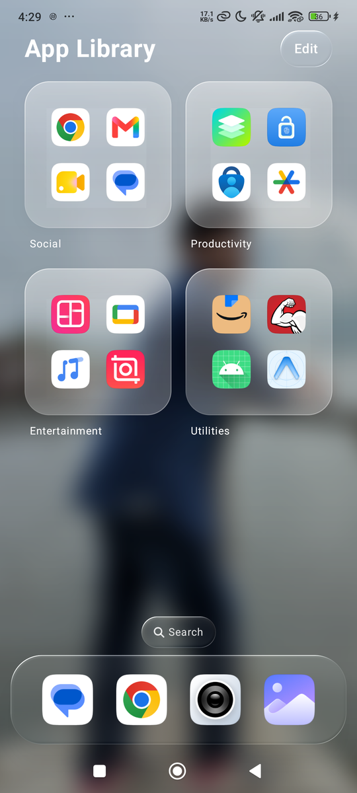
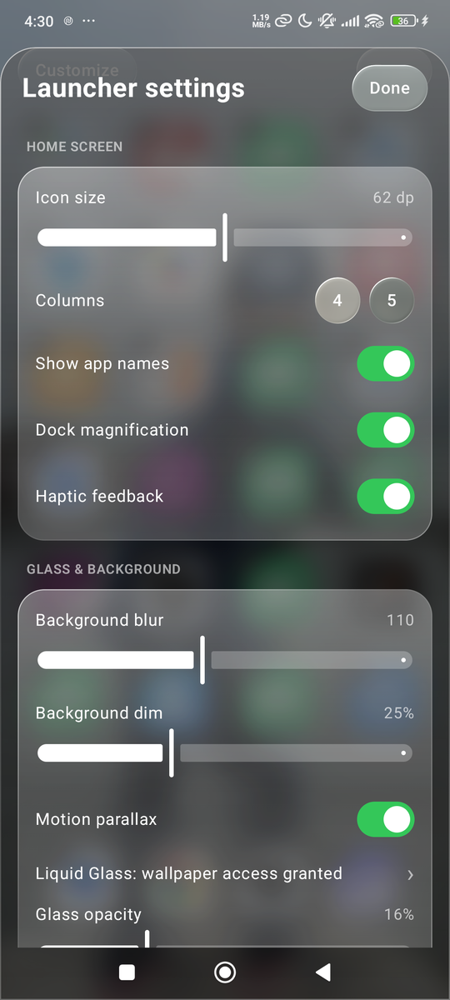
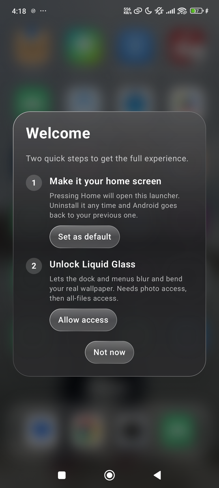

# iosLauncherOnAndroid

An Android home screen that feels like iOS 26 — **Liquid Glass** surfaces, springy icons, folders, an App Library, Spotlight-style search — written from scratch in Jetpack Compose.

<p align="center"></p>

<p align="center">
  
  
  
  
</p>
<p align="center">
  
  
  
  
</p>

## Features

**Look & feel**
- **Liquid Glass** — the dock, search pill, buttons and panels bend and split the light of your real wallpaper through a lens-shaped rim (an AGSL shader), with a specular highlight that moves as you tilt the phone.
- **Depth** — the wallpaper and icons shift with the gyroscope (a slow baseline is subtracted, so it works however you hold the phone).
- **App open / close zoom** — the icon grows into a fullscreen sheet and shrinks back into its slot when you return.
- Springs everywhere: press-down bounce, dock magnification, column-wave paging, haptic ticks.

**Home screen**
- Jiggle mode (hold empty space) with minus badges; **hold + drag** to rearrange with live reflow, flip pages by holding at the edge, **drop one icon on another to make a folder** (expanding glass panel, renameable).
- Tap-outside to exit, a delete confirmation ("Delete App / Remove from Home Screen"), and a compact iOS-style quick-actions menu on long-press.
- **Today page** on one card grid: clock + next alarm, **Weather** (live, hourly), **Photos** (swipeable, parallax), **Music player** (real controls), analog clock, device rings, suggestions, and **Smart groups** — plus real Android widgets, filed automatically by type.
- **App Library** with Suggestions, Recently Added and on-device **smart categories** (rename it, add widgets, tap a tile to open the whole group).
- **Page dots scrub** like iOS: press and slide along them to fly between pages.
- Long-press a widget for a glass context menu; unread **notification badges** and app **quick actions** on icons.
- **Search** — swipe down or tap the pill: every app grouped A–Z with an iOS-style index (fisheye bulge, letter bubble, haptics), plus ~25 system settings and the launcher's own screens.
- **Wallpapers** — a private library, carousel preview, set lock / home / both, hold-and-swipe multi-select, and optional *change lock screen on every unlock*.
- Settings for icon size, columns, blur, dim, glass opacity, dock magnification, parallax, haptics, clock, hidden apps.

## Install

1. Download [`dist/iosLauncherOnAndroid.apk`](dist/iosLauncherOnAndroid.apk) and install it (`adb install -r dist/iosLauncherOnAndroid.apk`).
2. Open the app. A welcome card offers two steps:
   - **Set as default** — the standard Android "home app" dialog. Uninstall the launcher any time and Android returns to your previous one.
   - **Unlock Liquid Glass** *(optional)* — grants wallpaper access (photos permission, then *all-files access*) so the launcher can read the wallpaper it blurs and refracts. Without it you still get the blurred wallpaper (system blur) and flat frosted glass.

> The APK is signed with the debug key, so it is for sideloading, not the Play Store (all-files access is not permitted there).

## Requirements and compatibility

Android 7.0+ (API 24). Features degrade gracefully by version:

| Android | What you get |
|---|---|
| 7.0 – 7.1 (24–25) | Full launcher, flat frosted glass, gradient background (tested on an API 25 emulator) |
| 8.0 – 11 (26–30) | Above plus smart app categories from the Play Store category; no blur |
| 12 – 12L (31–32) | Real-time system blur of your wallpaper |
| 13+ (33+) | Liquid Glass shader with wallpaper refraction (after granting wallpaper access), default-launcher role dialog |

Tested on a Xiaomi Redmi (Android 15, 120 Hz), Pixel 8 emulator (Android 13) and a Nougat emulator (API 25), at 720×1280 and 1080×2400, and with 1.5× font scale. Lint reports no errors.

## Build

```bash
./gradlew :app:assembleRelease        # app/build/outputs/apk/release
./gradlew :app:testDebugUnitTest      # 21 unit tests (layout, search, grouping, spelling, weather)
```

## How it works (short)

| Piece | Where |
|---|---|
| Wallpaper → sharp + blurred copies (box blur on a 180 px bitmap) | `ui/glass/WallpaperBackdrop.kt` |
| Liquid Glass modifier + AGSL shader (SDF lens, dispersion, rim light, scrim-matched) | `ui/glass/LiquidGlass.kt` |
| Tilt sensor → parallax (Compose state read only in draw/graphics phase) | `ui/glass/Tilt.kt` |
| Home layout = one flat list chunked into pages; folders; JSON persistence | `data/HomeLayout.kt` |
| Grid with per-item spring placement, folder glyph, drag overlay | `ui/home/HomeGrid.kt` |
| Long-press-then-drag on the *Initial* pointer pass (so it beats the pager) | `ui/home/DragGestures.kt` |
| Icon → fullscreen launch animation | `ui/home/LaunchOverlay.kt` |
| A–Z index with fisheye | `ui/search/AlphabetRail.kt` |

Performance notes: icons are masked to the iOS squircle once (no per-frame clipping); animated values are read inside `graphicsLayer`/draw lambdas so scrolling never recomposes; the launcher draws **0 frames while idle**, and about 3–4 % of frames miss the deadline while paging on a 120 Hz phone.

## Known limits

- A launcher can't restyle the system lock screen — only its wallpaper (which this app can rotate).
- Portrait only.
- Weather uses Open-Meteo (no API key) and only sends rounded coordinates after you tap "Allow location".
- Badges and the Music widget need *Notification access* (turned on from Settings inside the launcher).
- To go back: Settings → "Use a different home app", or simply uninstall the launcher.
- Package names and the app label still use the working title `iosLauncherOnAndroid`.

## Screenshots note

The screenshots and demo use the author's own wallpaper; replace them with your own before publishing if you prefer.
